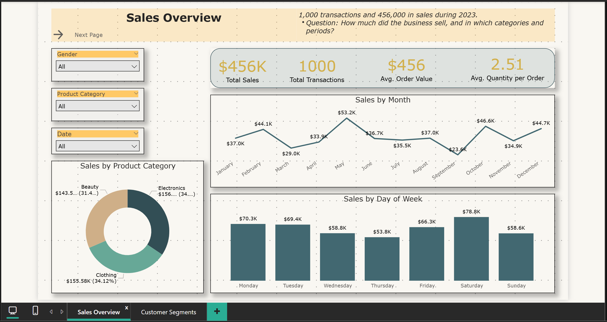

# Customer Segmentation Sales Analytics


[](screenshots/01_sales_overview.png)

*Select the image to view it at full size.*

---

## Project Overview

A two-page Power BI dashboard that shows how sales are spread across spend levels, age groups, gender and product categories. It identifies where revenue concentrates, so sales and account teams can see which customer groups matter most.

Sales teams need to know which customers generate most of the revenue, and whether that differs by age, gender or product category. Without this, effort is spread evenly when it should go to the groups that matter most.

The dataset has one year of transactions and one purchase per customer. Segments are based on spend, age, gender and category only. Repeat behaviour and customer lifetime value cannot be measured here.

### Data Source

**Data Source:** Secondary data obtained from publicly available online sources for educational and analytical practice. The dataset was used for data preparation, analysis, dashboard development, and business insights.

---

## Headline KPIs (2023)

| Total Sales | Transactions | Average Order Value | Units per Transaction |
|---|---|---|---|
| $456,000 | 1,000 | $456.00 | 2.51 |

*Currency: US dollars, assumed. The dataset does not state a currency.*

---

## Business Questions

1. How concentrated is revenue across customer spend levels?
2. Do age groups or gender differ in spend and order value?
3. Do age or gender relate to product category choice?
4. When in the year and the week do sales peak?

---

## Dataset

| Item | Detail |
|---|---|
| Rows | 1,000 transactions, 1,000 customers (one transaction each). No nulls or duplicates |
| Period | 1 January 2023 to 1 January 2024 (one year) |
| Fields | Transaction ID, Date, Customer ID, Gender, Age (18 to 64), Product Category, Quantity (1 to 4), Price per Unit, Total Amount |
| Categories | Clothing 351, Electronics 342, Beauty 307 |

### Limitations of the data
- **One purchase per customer.** Repeat purchase, recency and customer lifetime value cannot be analysed.
- **Price points are shared across categories.** Price per Unit takes only five values (25, 30, 50, 300, 500), the same across categories. Category revenue is an indicator, not a true price comparison.
- **One year only.** Seasonal patterns cannot be confirmed.
- **No cost or profit data.** Only sales are measured.

---

## Data Model and Preparation

- The transaction table is used as provided. Total Amount equals Quantity × Price per Unit for every row.
- Calculated columns: **Age Group** (18–25, 26–35, 36–45, 46–55, 56–64) and **Spend Tier** (Under 100, 100–499, 500–999, 1000+).
- Spend tiers stand in for recency and frequency, which the data does not support.

---

## Key Findings

All figures are reproduced by [`script/segment_checks.py`](script/segment_checks.py). Differences are descriptive unless a test is stated.

1. **Revenue is concentrated in the highest spend tier.** Transactions of 1,000 or more are 20.2% of transactions but 62.9% of revenue. Transactions under 100 are 34.9% of transactions and 4.0% of revenue.

2. **Sales are spread fairly evenly across age groups.** The 46–55 group is largest (100,690, 22.1% of sales), followed by 26–35 (98,480). The 56–64 group is smallest (80,410).

3. **Average order value falls with age, but the difference is not statistically clear.** It goes from 500 (18–25) to 412 (56–64). A Kruskal-Wallis test on transaction amount by age group gives p = 0.44.

4. **Gender shows no meaningful difference.** Female customers account for 51.1% of sales (232,840). Average order value is 457 for women and 455 for men (Kruskal-Wallis p = 0.77).

5. **Category choice does not vary by age or gender in a statistically clear way.** Chi-square tests give p = 0.64 for age against category and p = 0.43 for gender against category. Category totals are close: Electronics 156,905, Clothing 155,580, Beauty 143,515.

6. **Saturday is the strongest sales day** (78,815), and Thursday the weakest (53,835). May was the strongest month (53,150), and September the weakest (23,620).

7. **Quantity per transaction is evenly spread** across 1 to 4 units, so order size gives no segment signal.

### Suggested actions (for discussion, not tested)

- Protect and grow the top spend tier. It carries most of the revenue, so retention offers and account attention matter most there.
- Test whether the top tier buys again. The current data cannot show this, so the next step is to collect customer IDs across periods.
- Plan promotional activity around Saturday and May, the strongest periods here, and test whether the pattern holds with more than one year of data.

---

## Dashboard

The Power BI report has two pages.

| Page | Purpose |
|---|---|
| **Sales Overview** | Totals, monthly trend, category mix and day-of-week pattern |
| **Customer Segments** | Revenue share by spend tier, sales and order value by age group, and the age-by-category matrix |

---

## Tools and Techniques

- **Python:** pandas for segment tables; SciPy for the chi-square and Kruskal-Wallis tests.
- **Power BI:** calculated columns for age and spend bands, DAX measures for shares and averages, slicers and a matrix.

---

## Repository Structure

```text
customer-segmentation-sales-analytics/
├── README.md
├── dashboard/
│   └── customer_segmentation_dashboard.pbix
├── data/
│   └── retail_sales_dataset.csv
├── documentation/
│   └── measures.dax
├── script/
│   └── segment_checks.py
└── screenshots/
    ├── 01_sales_overview.png
    └── 02_customer_segments.png
```

---

## How to Reproduce

**Python checks**

```bash
pip install pandas scipy
python script/segment_checks.py
```

**Dashboard**

Open `dashboard/customer_segmentation_dashboard.pbix` in Power BI Desktop. If a file error appears, point the source to `data/retail_sales_dataset.csv` (Home > Transform data > Data source settings).

---

## Limitations

- **One purchase per customer.** No repeat, recency or lifetime-value analysis.
- **Shared price points.** Category revenue reflects the product mix, not price differences.
- **One year.** No seasonal confirmation.
- **Sales only.** No cost, margin or profit.
- **Association, not cause.** Spend tiers describe the customers in this file, not what drives their spend.

---

## Disclaimer

This is a portfolio project using secondary data. Results describe that dataset only and do not represent any retailer's customers.

---

**Author:** [Sarthak Jaykar](https://www.linkedin.com/in/sarthak-jaykar/)
